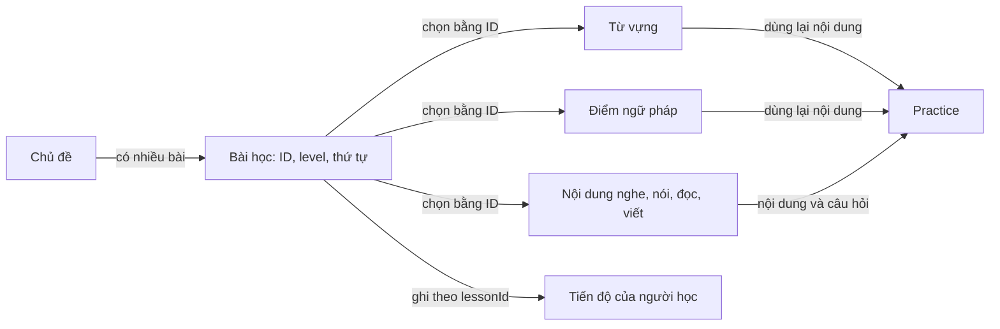

# Phân tích dữ liệu và kế hoạch làm Lessons cho Huy

## 1. Kết luận trước

Dữ liệu hiện tại **đủ để dựng màn hình mẫu**, nhưng **chưa đủ để tạo một hệ bài giảng hoàn chỉnh theo README**. Kho từ, điểm ngữ pháp và bài kỹ năng đã có; phần thiếu lớn nhất là danh sách bài học nối chúng thành một lộ trình có mục tiêu, thứ tự và tiến độ rõ ràng.

Với phần việc của Huy, nên làm trước một đường đi trọn vẹn: **chọn level → chọn chủ đề → chọn bài → học nội dung → chuyển sang luyện tập → ghi nhận hoàn thành**. Dùng một tập nội dung nhỏ được kiểm duyệt để hoàn thiện đường đi này, rồi mở rộng. Không cần biên soạn đủ A1–C1 hay biến toàn bộ kho từ thành bài giảng ngay từ đầu.

Phân tích này dựa trên [README chính](../../../README.md), [dữ liệu dùng chung](../../data/README.md) và dữ liệu trong feature Lessons. Các cấu trúc đề xuất bên dưới chưa được triển khai vào mã.

## 2. Nhìn nhanh vào `src/data`

| File | Hiện chứa gì? | Huy nên dùng thế nào? |
| --- | --- | --- |
| `vocabulary-en.json` | 10.000 mục từ nguồn, khoảng 8,48 MB trước khi nén | Kho để chọn từ; không coi mỗi mục từ là một bài học |
| `vocabulary-en.ts` | Kiểu dữ liệu và bộ lọc: 4.129 mục dùng cho người học, 5.871 mục chờ rà soát | Dùng `PRODUCTION_VOCABULARY` hoặc adapter Lessons; tránh lấy toàn bộ kho nguồn |
| `vocabulary-topics.ts` | 15 nhóm chủ đề với ID, tên và mô tả | Nên làm danh sách ID chủ đề dùng chung |
| `vocabulary-exam.ts` | Nhãn liên quan TOEIC/IELTS, học thuật, kinh doanh | Dùng lọc tham khảo; không phải danh sách từ thi chính thức |
| `content.ts` | 8 chủ đề giao diện, 3 bài nghe, 2 bài đọc, 3 đề viết, 3 câu nói và 6 tình huống Tutor | Nội dung mẫu để làm UI; cần tách và bổ sung khi xây bài thật |
| `grammar.ts` | Chuyển tiếp sang dữ liệu ngữ pháp trong feature Lessons | Không có bộ ngữ pháp riêng ở đây |
| `tutors.ts` | Chuyển tiếp sang dữ liệu Tutor | Thuộc phần của Khánh; Huy chỉ dùng lại khi có nhu cầu |
| `plans.ts` | Các gói Free/Plus/Pro và giá hiển thị | Không phải kế hoạch bài giảng và không xác nhận người dùng đã trả phí |

Các file `topics`, `listening`, `reading`, `speaking`, `writing` trong `src/features/lessons/data/` chủ yếu đưa lại dữ liệu từ `src/data/content.ts`. File `vocabulary.ts` lọc/tra cứu kho dùng chung. Riêng `src/features/lessons/data/grammar.ts` mới là nơi giữ **15 điểm ngữ pháp**: A1 có 4, A2 có 3, B1 có 3, B2 có 3 và C1 có 2.

Nói cách khác, thư mục feature có nhiều tên file, nhưng phần lớn chưa chứa bộ bài giảng độc lập. `LessonsScreen.tsx` hiện còn trống.

## 3. Dữ liệu bài giảng đã khớp README đến đâu?

README giao cho Huy luồng **Lessons Hub → CEFR A1–C1 → Topic → Lesson → nội dung từ vựng/ngữ pháp/bốn kỹ năng → Lesson Progress**. Hiện trạng mới đáp ứng một phần:

| Phần cần có | Hiện trạng | Đánh giá |
| --- | --- | --- |
| Danh sách bài học | Có kiểu `LessonDefinition`, nhưng chưa có danh sách các bài dùng kiểu này | Thiếu phần nối nội dung thành bài; đây là việc cần làm đầu tiên |
| Chủ đề và level | Có 8 chủ đề giao diện, mỗi chủ đề gắn một level; danh sách này chưa có C1 | Chưa đủ để dựng lộ trình A1–C1 theo README |
| Từ vựng | Có kho lớn, ID ổn định và hàm lọc | Phù hợp làm nguồn tra cứu; cần chọn từ cho từng bài thay vì lấy ngẫu nhiên |
| Ngữ pháp | Có công thức, giải thích ngắn và ví dụ cho 15 điểm | Đủ mở màn chi tiết mẫu; thiếu mục tiêu, lỗi thường gặp và liên kết bài luyện |
| Nghe/đọc | Có nội dung và một câu hỏi lựa chọn cho mỗi bài mẫu | Đủ minh họa; thiếu liên kết chủ đề, giải thích đáp án và nhiều câu hỏi khi cần |
| Nói/viết | Có câu nói và đề viết/tip | Chưa thành bài có hướng dẫn, tiêu chí hoàn thành và ví dụ sử dụng rõ |
| Tiến độ bài học | `LearningState` có `completedLessonIds` | Ghi được bài đã xong; chưa có vị trí đang học hoặc tiến độ chi tiết từng bài |

### Ba vấn đề cụ thể nên xử lý sớm

**ID chủ đề chưa thống nhất.** `learningTopics` dùng `daily-life`, còn kho từ dùng `daily`. Truyền `daily-life` vào hàm `getVocabularyByTopic()` hiện không ra từ; truyền `daily` thì có. Hai danh sách chủ đề cũng không hoàn toàn trùng nhau. Nên thống nhất một bộ ID và tạo ánh xạ cho tên cũ trước khi nối UI.

**Ví dụ từ vựng chưa đủ chất lượng để dạy cách dùng.** Cả 4.129 mục qua bộ lọc hiện đều có `exampleQuality: generated`. Nhiều câu chỉ là mẫu như “Please remember the meaning of ‘library’” hoặc “We are learning how to use ‘mother’ in context.” Chúng có chứa từ, nhưng không minh họa nghĩa/cách dùng tự nhiên như “My mother works at a hospital.” Có 3.597 câu thuộc bốn mẫu nhắc tới từ theo kiểu này. Vì vậy, “qua bộ lọc production” chưa đồng nghĩa đã được người duyệt thành nội dung bài giảng. Nhãn CEFR cũng đang là ước lượng theo tần suất.

**Bài nghe thiếu âm thanh và có câu hỏi cần rà lại.** `content.ts` mới có transcript, chưa có đường dẫn audio; `assets/` hiện chỉ có các ảnh nhận diện ứng dụng. Có thể dùng TTS đọc transcript cho bản mẫu và ghi rõ lựa chọn này. Riêng `listen-1` hỏi địa điểm với đáp án “At a library”, nhưng transcript chỉ nói về ghế trống và chờ bạn; cần thêm chi tiết trong nội dung nghe để đáp án có căn cứ.

Các nội dung mẫu cũng chưa có `topicId`, nguồn/người duyệt và phiên bản đầy đủ. Không nên mở tất cả level trong UI như thể đã có giáo trình tương ứng; level chưa có bài cần hiện trạng thái chưa có nội dung.

## 4. Nên tổ chức một bài học thế nào?

**Bài học cần là một mục riêng, chỉ tham chiếu tới nội dung bằng ID.** Không chép lại nguyên nghĩa của từ hay cả bài ngữ pháp vào mỗi bài. Một từ hoặc điểm ngữ pháp có thể xuất hiện ở nhiều bài và được Practice dùng lại.

`LessonDefinition` hiện có `id`, `title`, `level`, `topicId`, `description` và các danh sách ID cho sáu loại nội dung. Đây là nền tốt để bắt đầu. Nên bổ sung:

| Trường đề xuất | Ý nghĩa dễ hiểu |
| --- | --- |
| `objectives` | Học xong bài này làm được gì? |
| `order` | Bài đứng thứ mấy trong chủ đề/level? |
| `estimatedMinutes` | Thời gian học dự kiến |
| `status` | Bản nháp hay được phép hiển thị cho người học |
| `contentVersion` | Phiên bản nội dung để nhận biết khi bài được sửa |

Ví dụ dưới đây là **cấu trúc đề xuất**, không phải một bài đã hoàn thiện. ID từ “mother” và điểm ngữ pháp `a1-be` có thật trong dữ liệu hiện tại:

```json
{
  "id": "lesson-family-a1-01",
  "title": "Giới thiệu gia đình",
  "level": "A1",
  "topicId": "family",
  "description": "Gọi tên người thân và giới thiệu bằng câu ngắn.",
  "objectives": ["Gọi tên người thân", "Nói một câu giới thiệu đơn giản"],
  "vocabularyIds": ["local-en-00210"],
  "grammarIds": ["a1-be"],
  "listeningIds": [],
  "speakingIds": [],
  "readingIds": [],
  "writingIds": [],
  "order": 1,
  "estimatedMinutes": 10,
  "status": "draft",
  "contentVersion": 1
}
```

Một bài **không cần chứa đủ sáu phần**. Bài từ vựng/ngữ pháp có thể đứng riêng, bài nghe/đọc cũng có thể đứng riêng; feature Lessons cần hỗ trợ các loại bài đó. Ban đầu có thể dùng thứ tự hiển thị cố định và các danh sách ID hiện có. Chỉ thêm cấu trúc “các phần của bài” linh hoạt khi thật sự cần đổi thứ tự hoặc lồng nhiều loại nội dung.

Chủ đề nên có ID và tên chung; **level đặt ở bài học**. Ví dụ “Education” có thể có bài A1 lẫn B1, thay vì bị khóa toàn bộ ở B1. Các nhãn chủ đề/level của từ giúp tìm kiếm, nhưng danh sách từ đã chọn trong bài mới quyết định nội dung được dạy. Không bắt buộc mọi từ của bài phải có đúng nhãn chủ đề giống bài trong kho nguồn.

Đối với nghe/đọc, nên có danh sách câu hỏi với ID riêng, đáp án và giải thích. Lựa chọn nên có ID ổn định thay vì chỉ dùng `answer: 0`, vì đảo thứ tự lựa chọn có thể làm sai đáp án nếu không đổi chỉ số theo. Huy và Dương cần thống nhất cấu trúc này để cùng sử dụng bài luyện.

## 5. Nên lưu dữ liệu ở đâu?

### Trong giai đoạn dựng feature

**Giữ nội dung mẫu trong repo** là phù hợp với guest-first và kế hoạch hiện tại: dễ mở bài, chạy offline, kiểm tra thay đổi và không phải chờ backend để dựng UI. Có thể dùng TypeScript cho danh sách bài/config nhỏ; JSON cho kho nội dung lớn; ảnh/audio nằm ở `assets/` và được tham chiếu bằng ID hoặc đường dẫn qua lớp đọc tài sản.

Đích tổ chức nên theo README:

```text
src/data/
├── topics/          # Một danh sách chủ đề dùng chung
├── lessons/         # Danh sách bài, mục tiêu, thứ tự và các ID nội dung
├── vocabulary/      # Kho từ và bộ lọc chất lượng
├── grammar/         # Giải thích, công thức, ví dụ, lỗi thường gặp
├── listening/       # Transcript và tham chiếu audio/câu hỏi
├── speaking/        # Câu mẫu, tình huống và hướng dẫn luyện
├── reading/         # Đoạn đọc và tham chiếu câu hỏi
├── writing/         # Đề viết, hướng dẫn và ví dụ
└── questions/       # Câu hỏi tự luyện dùng chung khi đã chốt với Dương

src/features/lessons/
├── data/            # Cách lấy/ghép dữ liệu để hiển thị trong Lessons
├── types/           # Kiểu dành riêng cho UI Lessons
├── hooks/           # Logic chọn bài, tải bài và xử lý trạng thái
└── screens/         # Danh sách bài và màn học
```

`lessons/` và `questions/` là phần đề xuất bổ sung; các thư mục con trên chưa tồn tại đầy đủ. Không cần đổi toàn bộ đường dẫn trước khi làm bài mẫu.

**Bước thực tế cho Huy:** tạo danh sách bài ở `src/features/lessons/data/lessons.ts` trước, dùng các ID hiện có. Đây là danh sách ghép bài, không phải bản sao kho từ. Sau khi nhóm chốt cấu trúc dùng chung, chuyển nguồn danh sách bài sang `src/data/lessons/` và giữ file feature làm đầu đọc dữ liệu.

Ngữ pháp hiện đặt trong Lessons nhưng Practice đang nhập trực tiếp từ đó, còn `src/data/grammar.ts` lại chuyển tiếp về feature. Về lâu dài nên đảo lại: dữ liệu ngữ pháp gốc ở `src/data/grammar/`, hai feature đọc cùng nguồn. Cần phối hợp với Dương/Hải và giữ đường dẫn cũ chuyển tiếp trong lúc chuyển, vì Home/Practice/Tutor cũng đang dùng một số dữ liệu liên quan.

Kho JSON hiện được đóng gói cả 10.000 mục rồi mới lọc khi app chạy. Bộ lọc không tự giảm dung lượng file tải. Nếu đo thấy ảnh hưởng khởi động, có thể tạo riêng file chứa tập được phép dùng cho người học; không cần đưa toàn bộ kho nguồn sang bản ứng dụng chỉ để giữ con số 10.000.

### Khi có quản trị và cập nhật nội dung từ xa

Khi admin cần sửa/phát hành bài mà không phát hành lại ứng dụng, nên chuyển **nội dung được công bố và quan hệ giữa các mục** lên Supabase PostgreSQL. Ảnh/audio do admin tải lên nên ở Supabase Storage; database chỉ lưu đường dẫn, mô tả và thông tin quyền sử dụng. File JSON trong repo có thể làm dữ liệu nhập ban đầu hoặc bản nội dung offline có phiên bản.

Cần chọn một nguồn nội dung được công bố làm chuẩn. Không để admin sửa trên Supabase trong khi app vẫn âm thầm đọc bản JSON cũ mà không kiểm tra phiên bản. Bản nháp nằm ở phía máy chủ, không đóng gói trong app cho mọi người xem.

**AsyncStorage dùng cho tiến độ, draft câu viết và nội dung đã tải lại**, không phải nơi cả nhóm cùng biên soạn hay xuất bản bài giảng. Tiến độ tài khoản đồng bộ lên Supabase qua phần của Hải. Không lưu cả nội dung bài học vào từng hồ sơ người học.

## 6. Có cần sơ đồ quan hệ dữ liệu không?

**Có, nên chốt ngay một sơ đồ nhỏ cùng cách đặt ID.** Nó giúp Huy, Dương và Hải hiểu cùng một bài/từ/câu hỏi. Chưa cần dựng nhiều bảng database ngay; các quan hệ này có thể được lưu bằng danh sách ID trong file trước.



Quy định bằng lời cũng cần đi cùng sơ đồ:

- Một chủ đề có nhiều bài; mỗi bài của bản đầu có một chủ đề chính và một level.
- Một bài có nhiều mục nội dung; một từ/điểm ngữ pháp có thể được nhiều bài dùng lại.
- Một bài nghe/đọc có thể có nhiều câu hỏi. Câu hỏi và các lựa chọn có ID riêng, giữ liên kết với nội dung gốc.
- Một người học có tiến độ riêng cho mỗi bài; không dùng title làm khóa lưu tiến độ.
- Ảnh/audio có ID hoặc đường dẫn được kiểm tra, kèm mô tả và nguồn/quyền sử dụng.

Không phải tạo bảng riêng cho mỗi level; A1/B1 là thuộc tính của bài. Nếu chuyển sang database, Hải sẽ chọn cách lưu các liên kết, nhưng phải giữ nguyên nghĩa của quan hệ và ID mà UI/Practice đang dùng.

## 7. Những điều Huy nên chốt với Dương và Hải

**Với Dương:** nút “Luyện bài này” sẽ gửi `lessonId`, các ID nội dung cần luyện và phiên bản bài. Dương phụ trách chấm quiz/ghi kết quả luyện; Huy tránh tự ghi thêm cùng một lượt trả lời làm tăng điểm hai lần. Hai người cùng chốt câu hỏi, đáp án, giải thích và trường cho câu có ảnh.

**Với Hải:** định nghĩa thế nào là hoàn thành bài, cách gọi `completeLesson(lessonId)` và nhu cầu lưu vị trí đang học. Hiện Context chỉ giữ danh sách bài hoàn thành; nếu UI cần “tiếp tục từ phần đang dở”, phải bổ sung dữ liệu như `lessonId`, `contentVersion`, mục đang xem và thời điểm hoàn thành. Ghi yêu cầu trước khi sửa file core.

**Trong phạm vi của Huy:** các màn list/detail, danh sách bài mẫu, cách ghép nội dung, empty/error/loading và việc kiểm duyệt bài. Không tự thay migration hay logic đồng bộ tài khoản để giải quyết một nhu cầu UI mà chưa thống nhất với Hải.

## 8. Thứ tự làm đề xuất

1. **Chốt ID và loại bài:** dùng bộ chủ đề chung, ánh xạ `daily-life` → `daily`, giữ ID từ/bài ổn định.
2. **Tạo một bài A1 có thể học thật:** mục tiêu rõ, chọn từ/ngữ pháp phù hợp và viết lại các ví dụ còn chung chung. Không lấy ngẫu nhiên kho từ để tạo lộ trình.
3. **Nối giao diện:** chọn level/chủ đề/bài, mở nội dung, chuyển sang Practice, ghi nhận hoàn thành bằng API Context đã thống nhất.
4. **Bổ sung từng kỹ năng:** ít nhất một bài mẫu nghe/nói/đọc/viết có hướng dẫn và tiêu chí hoàn thành; phần chưa có nội dung hiện trạng thái trống rõ ràng.
5. **Tách nguồn dùng chung:** phối hợp chuyển ngữ pháp và dữ liệu kỹ năng ra cấu trúc `src/data/` khi đường đọc/ID đã ổn định.
6. **Sau khi bản local hoạt động:** cùng Hải triển khai nội dung xuất bản trên Supabase nếu nhóm làm admin/cập nhật từ xa trong giai đoạn tiếp theo.

Trước khi đánh dấu bài sẵn sàng: không thiếu ID tham chiếu; từ thuộc tập cho phép; nội dung/ví dụ được duyệt; câu hỏi có một đáp án đúng và giải thích; audio/ảnh có thể đọc; title/level/topic phù hợp; trạng thái hoàn thành được ghi và mở lại vẫn đúng. Đây là kiểm tra nội dung và liên kết, không chỉ kiểm tra màn hình có hiển thị.

## 9. Các file nên đọc tiếp

- [Phần việc Lessons trong README](../../../README.md#-huy--module-bài-học)
- [Nội dung mẫu hiện tại](../../data/content.ts)
- [Danh sách chủ đề của kho từ](../../data/vocabulary-topics.ts)
- [Điểm ngữ pháp hiện tại](data/grammar.ts)
- [Kiểu LessonDefinition đang có](types/index.ts)
- [Bộ lọc từ vựng dành cho Lessons](data/vocabulary.ts)
- [LearningContext và API tiến độ](../../contexts/LearningContext.tsx)
- [Quy tắc nội dung của dự án](../../../docs/04-content.md)
