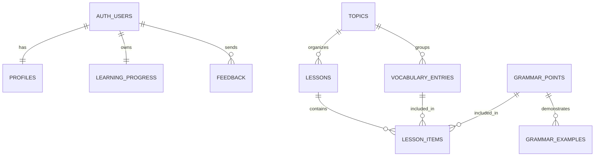

# HustLingo Supabase

HustLingo 1.1 không cần Express, PostgreSQL tự host, Docker hoặc Docker Compose.
Supabase cung cấp:

- Auth: email/password and Google.
- PostgreSQL hosted.
- Row Level Security (RLS).
- Profile, learning progress, feedback.
- Danh mục nội dung: chủ đề, từ vựng, grammar và lesson liên kết.

Schema nằm trong các file `migrations/`. Migration nội dung là
`migrations/202610160001_content_catalog.sql`.

## Cách nhanh nhất

1. Tạo project tại Supabase Dashboard.
2. Mở SQL Editor.
3. Chạy lần lượt các migration trong `migrations/`.
4. Project Settings / Connect: copy Project URL và Publishable key vào `.env`.
5. Authentication -> Providers: bật Google.
6. Authentication -> URL Configuration: thêm redirect URL của app.

Không đưa `service_role` key vào app Expo.

## Bật đăng nhập Google cho Expo Web

Luồng web dùng Supabase OAuth với PKCE. Callback nằm tại `/oauth`; không cần
thêm Google Client ID hoặc Client Secret vào `.env` của Expo.

1. Trong Google Cloud Console, tạo hoặc chọn project rồi mở Google Auth Platform.
2. Cấu hình Branding và Audience; khi ứng dụng ở chế độ Testing, thêm các tài khoản Google cần thử làm test users. Trong Data Access, bảo đảm có scope `openid` cùng email và hồ sơ cơ bản.
3. Tạo OAuth Client ID loại **Web application**.
4. Trong **Authorized JavaScript origins**, thêm `http://localhost:8081` và `https://hustlingo.expo.app`.
5. Trong **Authorized redirect URIs**, thêm callback URL được hiển thị ở Supabase Dashboard → Authentication → Sign In / Providers → Google. Đây thường là `https://<project-ref>.supabase.co/auth/v1/callback`; dùng đúng URL trong Dashboard.
6. Sao chép Client ID và Client Secret vào cấu hình Google provider tại Supabase Dashboard → Authentication → Sign In / Providers → Google, bật provider và lưu.
7. Trong Supabase Dashboard → Authentication → URL Configuration → Redirect URLs, thêm các địa chỉ app cần dùng:

   ```text
   http://localhost:8081/oauth
   http://127.0.0.1:8081/oauth
   hustlingo://oauth
   https://hustlingo.expo.app/oauth
   ```

   Domain production là `https://hustlingo.expo.app`. Nếu chỉ dùng web, có thể bỏ dòng `hustlingo://oauth`.

Client Secret chỉ lưu trong Supabase Dashboard. Không gửi secret qua chat, không thêm
tiền tố `EXPO_PUBLIC_`, và không lưu secret trong `.env` của frontend. Khi đổi port
Expo hoặc domain web, cập nhật cả Authorized JavaScript origins (Google) và Redirect
URLs (Supabase).

## Quan hệ dữ liệu



## Nhập dữ liệu học tập

Sau khi đã chạy migration nội dung, nhập dữ liệu hiện có từ project bằng Node:

Có thể dùng `.env` hiện có hoặc tạo file `.env.backend.local` ở thư mục gốc project (cả hai đều được Git ignore). Với file riêng cho backend, thêm:

```env
SUPABASE_URL=https://YOUR_PROJECT_REF.supabase.co
SUPABASE_SECRET_KEY=YOUR_SERVER_ONLY_SECRET_KEY
```

Trên Linux/macOS, giới hạn quyền đọc file rồi chạy importer:

```sh
# Chọn một dòng khớp với file đang giữ secret:
chmod 600 .env
# hoặc: chmod 600 .env.backend.local
npm run db:seed:content
```

Importer đọc `SUPABASE_URL` và `SUPABASE_SECRET_KEY` từ file backend này (hoặc environment của terminal), không đọc hay in key ra log. Nếu project chỉ còn legacy key, script cũng chấp nhận `SUPABASE_SERVICE_ROLE_KEY`. Nó đọc `src/data/vocabulary-en.json` và `src/features/lessons/data/grammar.ts`, rồi upsert theo lô. Nó đưa vào đủ 10.000 từ vựng, 98 điểm grammar cùng ví dụ; các bản production được công khai, còn bản review được lưu ở trạng thái riêng tư nhờ RLS. Nó tạo lesson từ từng điểm grammar và nhóm từ vựng theo chủ đề/trình độ. Có thể chạy lại sau khi cập nhật dữ liệu nguồn.

Lấy Project URL ở nút Connect của project; lấy secret key trong Settings → API Keys. Dùng key `sb_secret_...` cho importer. Secret key có quyền cao, bỏ qua RLS; chỉ giữ trong file local bị ignore hoặc môi trường backend, không gửi qua chat, không thêm tiền tố `EXPO_PUBLIC_`, không commit và không đưa vào app Expo. Publishable key của app vẫn là biến `EXPO_PUBLIC_SUPABASE_PUBLISHABLE_KEY`. Migration cấp quyền đọc nội dung đã publish cho anon/authenticated, còn client không có quyền sửa nội dung.

Màn hình Lessons ưu tiên tải grammar đã publish từ Supabase khi app có cấu hình; nếu chưa cấu hình, chưa nhập dữ liệu hoặc đang offline thì dùng bộ grammar đóng gói làm dự phòng. `supabaseData.getVocabulary()` cung cấp truy vấn từ vựng phân trang/lọc để nối vào màn hình từ vựng.
