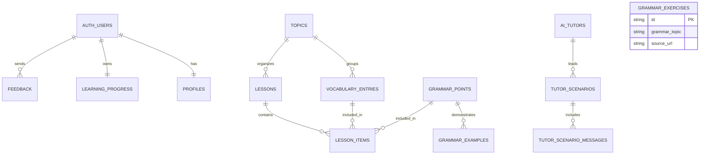

# HustLingo Supabase

HustLingo 1.1 không cần Express, PostgreSQL tự host, Docker hoặc Docker Compose.
Supabase cung cấp:

- Auth: email/password and Google.
- PostgreSQL hosted.
- Row Level Security (RLS).
- Profile, learning progress, feedback.
- Danh mục nội dung cho Bài học, Luyện tập và Gia sư AI.

Schema nằm trong các file `migrations/`. Nội dung feature được khai báo trong
`202610160001_content_catalog.sql`, `202610210001_practice_tutor_catalogs.sql` và
`202610210002_grammar_exercise_catalog.sql`.

## Cách nhanh nhất

1. Tạo project tại Supabase Dashboard.
2. Mở SQL Editor.
3. Chạy lần lượt các migration trong `migrations/`.
4. Project Settings / Connect: copy Project URL và Publishable key vào `.env`.
5. Authentication -> Providers: bật Google.
6. Authentication -> URL Configuration: thêm redirect URL của app.

Không đưa `service_role` key vào app Expo.

## Bật đăng nhập Google cho Expo Web

Luồng web dùng Supabase OAuth với PKCE. Callback nằm tại `/oauth`; không cần
thêm Google Client ID hoặc Client Secret vào `.env` của Expo.

1. Trong Google Cloud Console, tạo hoặc chọn project rồi mở Google Auth Platform.
2. Cấu hình Branding và Audience; khi ứng dụng ở chế độ Testing, thêm các tài khoản Google cần thử làm test users. Trong Data Access, bảo đảm có scope `openid` cùng email và hồ sơ cơ bản.
3. Tạo OAuth Client ID loại **Web application**.
4. Trong **Authorized JavaScript origins**, thêm `http://localhost:8081` và `https://hustlingo.expo.app`.
5. Trong **Authorized redirect URIs**, thêm callback URL được hiển thị ở Supabase Dashboard → Authentication → Sign In / Providers → Google. Đây thường là `https://<project-ref>.supabase.co/auth/v1/callback`; dùng đúng URL trong Dashboard.
6. Sao chép Client ID và Client Secret vào cấu hình Google provider tại Supabase Dashboard → Authentication → Sign In / Providers → Google, bật provider và lưu.
7. Trong Supabase Dashboard → Authentication → URL Configuration → Redirect URLs, thêm các địa chỉ app cần dùng:

   ```text
   http://localhost:8081/oauth
   http://127.0.0.1:8081/oauth
   hustlingo://oauth
   https://hustlingo.expo.app/oauth
   ```

   Domain production là `https://hustlingo.expo.app`. Nếu chỉ dùng web, có thể bỏ dòng `hustlingo://oauth`.

Client Secret chỉ lưu trong Supabase Dashboard. Không gửi secret qua chat, không thêm
tiền tố `EXPO_PUBLIC_`, và không lưu secret trong `.env` của frontend. Khi đổi port
Expo hoặc domain web, cập nhật cả Authorized JavaScript origins (Google) và Redirect
URLs (Supabase).

## Quan hệ dữ liệu



`GRAMMAR_POINTS` lưu các điểm dạy ngữ pháp theo CEFR; `GRAMMAR_EXAMPLES` lưu ví dụ.
`GRAMMAR_EXERCISES` lưu bài trắc nghiệm điền khuyết nguyên bản từ dataset GitHub,
được phân trang theo chủ đề. Bảng bài tập không gán CEFR vì bộ nguồn không cung cấp
trình độ CEFR cho từng câu.

`PRACTICE_CONTENT` lưu listening, reading, writing và speaking theo skill. Nội dung
được truy vấn qua `learningContentService` tại `src/services/learningContent.ts`.

## Nhập dữ liệu học tập

Sau khi đã chạy migration nội dung, nhập dữ liệu hiện có từ project bằng Node:

Có thể dùng `.env` hiện có hoặc tạo file `.env.backend.local` ở thư mục gốc project (cả hai đều được Git ignore). Với file riêng cho backend, thêm:

```env
SUPABASE_URL=https://YOUR_PROJECT_REF.supabase.co
SUPABASE_SECRET_KEY=YOUR_SERVER_ONLY_SECRET_KEY
```

Trên Linux/macOS, giới hạn quyền đọc file rồi chạy importer:

```sh
# Chọn một dòng khớp với file đang giữ secret:
chmod 600 .env
# hoặc: chmod 600 .env.backend.local
npm run db:seed:content
```

Importer đọc `SUPABASE_URL` và `SUPABASE_SECRET_KEY` từ file backend này (hoặc environment của terminal), không đọc hay in key ra log. Nếu project chỉ còn legacy key, script cũng chấp nhận `SUPABASE_SERVICE_ROLE_KEY`. Sau khi chạy tất cả migration, chạy `npm run db:seed:content`. Script upsert theo lô từ vocabulary, grammar, chủ đề, lesson, practice/tutor và 27.514 bài tập grammar từ GitHub. Chạy lại an toàn: script dùng upsert, không truncate bảng, không xóa profiles, tiến độ học hay feedback.

Nguồn hiện tại có 10.000 mục từ vựng, 98 điểm grammar cùng 196 ví dụ, 27.514 câu hỏi
grammar từ GitHub trên 19 chủ đề, 11 mục luyện tập (3 listening, 2 reading, 3 writing,
3 speaking), 2 gia sư, 6 tình huống và 4 tin nhắn hội thoại mẫu. Bộ câu hỏi grammar
không có CEFR theo từng câu; giữ nguyên nội dung gốc và chỉ sử dụng trong demo môn học
phi thương mại. Xem `seed/GRAMMAR_DATASET_ATTRIBUTION.md` để biết attribution và điều
khoản nguồn.

### Seed qua GitHub Actions

Có thể nhập bằng GitHub mà không đưa secret vào source code:

1. Trong GitHub repository, mở **Settings → Secrets and variables → Actions**.
2. Thêm repository secrets `SUPABASE_URL` và `SUPABASE_SECRET_KEY`.
3. Mở **Actions → Seed Supabase learning content → Run workflow**.

Workflow chỉ chạy thủ công, dùng secret ở phía GitHub Actions và gọi cùng importer
`npm run db:seed:content`. Không đặt service/secret key vào `EXPO_PUBLIC_*`, app Expo,
issue, commit hoặc chat.

### Chạy migrations nếu Supabase thiếu bảng

Trong Supabase Dashboard → **SQL Editor**, chạy theo thứ tự:

1. `migrations/202610050001_init_hustlingo.sql`
2. `migrations/202610160001_content_catalog.sql`
3. `migrations/202610210001_practice_tutor_catalogs.sql`
4. `migrations/202610210002_grammar_exercise_catalog.sql`

Sau đó chạy `npm run db:seed:content` ở máy đã có Node.js, hoặc chạy workflow GitHub
Actions ở trên. Migrations tạo bảng; importer mới thêm các hàng dữ liệu.

Kiểm tra bảng mới và số lượng grammar sau khi seed trong SQL Editor:

```sql
select table_name
from information_schema.tables
where table_schema = 'public'
order by table_name;

select grammar_topic, count(*) as exercise_count
from public.grammar_exercises
where is_published
group by grammar_topic
order by grammar_topic;
```

Lấy Project URL ở nút Connect của project; lấy secret key trong Settings → API Keys. Dùng key `sb_secret_...` cho importer. Secret key có quyền cao, bỏ qua RLS; chỉ giữ trong file local bị ignore hoặc môi trường backend, không gửi qua chat, không thêm tiền tố `EXPO_PUBLIC_`, không commit và không đưa vào app Expo. Publishable key của app vẫn là biến `EXPO_PUBLIC_SUPABASE_PUBLISHABLE_KEY`. Migration cấp quyền đọc nội dung đã publish cho anon/authenticated, còn client không có quyền sửa nội dung.

Các feature dùng `learningContentService` để truy vấn nội dung đã publish. `supabaseData`
chỉ giữ các thao tác hồ sơ, tiến độ học và feedback của tài khoản. UI tab Bài học,
Luyện tập và Gia sư hiện vẫn để trống theo trạng thái giao diện đã thống nhất.
